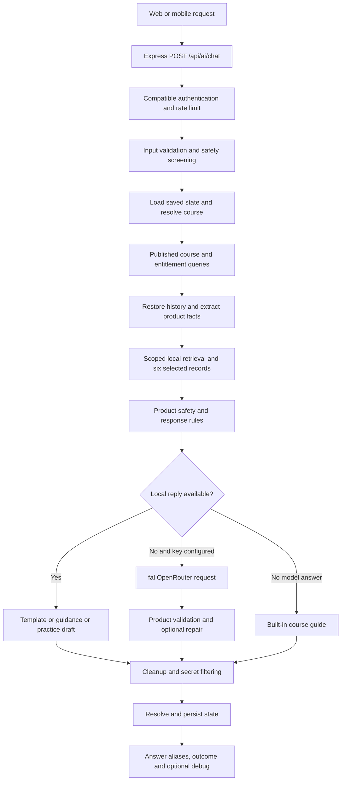

# Located implementation and request flow

Paths and line numbers refer to the current workspace relative to `Untitled/`. Backend paths below use the prefix `edunex-b/` unless stated otherwise. Source snapshots are included under `evidence/source_snapshot/`; integrity hashes identify the reviewed files. No semantic vector index, standalone translation service, learned intent classifier or structured model-extraction service was located in the active product-course path. Retrieval is local lexical ranking; extraction and routing are regular-expression functions.

## End-to-end flow

This diagram abbreviates early learner/platform direct replies and blocked-input early returns, documented below.

## 1. Entry points, clients and APIs

| Component | Located implementation | Behavior/dependencies |
|---|---|---|
| Backend registration | `server.js:192,1482` | Imports `routes/ai`, mounts `/api/ai` |
| Chat entry | `routes/ai.js:196–327,329` | `handleTutorChat`; Express router, compatible authentication, process-local limiter |
| Authentication | `middleware/compatAuth.js:78–130` | `authenticateCompatible`, `requireCompatibleAuth`; JWT verification or legacy user/session credentials, User lookup and session check |
| Limiter | `routes/ai.js:121–132` | `aiRateLimit`, Map by authenticated user/IP, 30 requests/minute/process |
| Web transport | `../edunex-f/js/nex-ai-widget.js:1840–1854` | `getAiReply`, `EduNex.authRequest`; sends message/history/course/lesson/page/assistant name; **omits local conversation ID** |
| Web chat state | Same file `1698–1726,1865–1870,1888–1903` | `beginNewConversation`, `switchConversation`; local ID/history and stale-render suppression |
| Mobile transport | `../appcopyai/services/aiClient.js:2–42` | `conversationHistory`, `requestTutor`, `tutorAnswer`; sends conversationId/courseId or activeCourseId, filters failed turns, last 12 messages; validates session identity |
| Mobile screen | `../appcopyai/App.js:11301–11314,11349–11401` | `clearAiHistory`, `sendAiMessage`; authenticated DELETE history, current conversation ID, generation guard |

Chat input accepts course aliases `courseId`, `activeCourseId`, `active_course_id`, or activeCourse object; `lessonId`, `history`, `conversationId`/`conversation_id`, `pagePath`, `assistantName`, `debugAi` are read by `routes/ai.js:202–224,261`. Output preserves `answer` and `reply`, `provider`, `sources` (currently an empty array in this handler), `messageId`, `notice`, `outcome`, `knowledge`, and optional `debug` (`routes/ai.js:311–323`). No API change is needed for the core fixes.

Other located endpoints: `/courses` returns published course/module summaries (`routes/ai.js:176–194`); `/health` reports key configuration (`168–174`); `/history` DELETE removes all this user's tutor session rows (`145–148`); `/reports` stores a response report (`150–166`). Legacy consent GET/PUT return the compatibility response (`134–143`). None of the mutating endpoints was called against a real server during this review.

## 2. Input safety and early response precedence

`services/aiCompliance.js:13–27` (`checkAiInput`) requires text, rejects empty/control-character input, caps at 2,000 characters and blocks instruction/secret leakage, filter bypass and specified sexual/minor patterns. Blocked input returns before retrieval/generation (`routes/ai.js:229–237`). These are existing finite regex protections, not a claim of exhaustive policy coverage.

`loadLearnerContext` and `learnerContextDirectReply` (`services/aiTutorService.js:629–776`) use subscription/order/user state for platform support; `skillomatePlanDirectReply` and `skillomatePlatformDirectReply` (`326–405`) run before course generation (`routes/ai.js:248–258`). The product fixes must not change that unrelated precedence. `buildContext` may assemble platform and learner context alongside course material; the Phase 12 harness removes non-course material at outbound transport. That projection belongs to the evaluation runner, not a separate production privacy layer.

## 3. Course and lesson identification, material access

`resolveRequestedCourseScope` (`services/aiTutorService.js:460–491`) prefers explicit normalized course identifiers, then a course detected in message/recent history, then saved active course. `loadTutorState` (`routes/ai.js:54–65`) fetches one row by user/course (invalid ObjectId becomes null) and ignores it if both saved/incoming chat IDs exist and differ.

`buildContext` (`services/aiTutorService.js:959–1009`) queries only published `models/Course`, ordinarily with the explicit ID or slug. It uses `Subscription`, `AppleSubscription`, `GooglePlaySubscription` and `services/subscriptionAccess.js:84–113` (`resolveAllSubscriptionAccess`) for `includeMaterials`. `Order`/other subscriptions also participate in learner context. Active lesson is validated against the active course's video IDs, provider IDs or index (`984–985`); page paths do not establish a lesson. `productLessonNumber`/`templateQuery` (`services/productTutorKnowledge.js:88–98,182–185`) interpret L/lesson and some Hindi aliases/digits. `productRequestContext` (`258–315`) infers task lesson, topic, procedural/troubleshooting flags and inherited topic. A valid selected lesson participates in retrieval context (`services/tutorKnowledge.js:202–204`). Explicit textual lessons and selected-video lessons can both influence ranking; precedence should be regression tested, not assumed equivalent.

Course isolation is enforced by `sameCourse`, active-course filtering and material candidate filtering (`services/tutorKnowledge.js:111–121,172–196`). Cross-course comparison is an explicit existing exception, detected by `allowsCourseComparison`; its broad English pattern must remain unchanged for this task. Product-specific response handling additionally gates on `isProductKnowledge` (`services/productTutorResponse.js:45–48`).

## 4. Knowledge storage, parsing, retrieval and ranking

`services/productTutorKnowledge.js:13,21–77` reads `knowledge/ai-product-photoshoot-ads/guidance.json` and `training.txt` at module initialization. `parseProductKnowledge` splits Parts B/D/E/F into overview/lesson-summary/workflow/FAQ/exact-template records, attaches reviewed translations/search terms/intent tags, and computes content/source/translation SHA-256 hashes. The English executable asset is stored as whitespace-normalized source text. Startup asserts **19 complete template assets and unique record IDs**. Eight lesson summaries are present. This is file-based content, not a live embedding database.

`services/tutorKnowledge.js:5–38,92–102` maps documented slugs to local course sources. For the product slug family it uses those parsed complete records instead of generic 1,800-character chunks. Generic course chunking (`71–82`) is not the product-template extraction method.

`retrieveKnowledge` (`172–297`) constructs course/lesson overviews and entitled course material, optionally validated lesson notes. `terms` (`55–57`) uses Unicode letters/numbers and an English/Hinglish stop list; there is no dedicated Hindi segmenter. The product candidate index includes headings/content/searchTerms and reviewed English translation (`217`). Scores combine term frequency and inverse document frequency with hand-defined boosts:

- Active lesson material: 100, or active lesson notes: 120; no contradictory explicit-lesson boost (`221–224`).
- Matching lesson: +30; matching product intent tag: +55; wrong explicit lesson: −35 (`225–229`).
- Workflow request boosts and scene-template boosts for composition/image outputs (`230–233`).
- Compound/whole-journey coverage boosts and explicit multi-lesson workflow boosts (`234–237`).
- Recognized requested template: +150 (`208,239`).

It sorts, deduplicates and keeps **six** records (`247–256`). Returned `records`, `excerpts`, `materialsAvailable`, requestContext and `debugChunks` carry rankings and provenance (`258–296`). Retrieval can miss a desired asset when intent failed to request its boost; therefore a global matching template is not permission to return it. Deterministic responses deliberately search only authorized retrieved templates (`services/productTutorResponse.js:123–124,142`).

`retrievalQueryFor` (`services/tutorKnowledge.js:154–165`) rewrites certain other-course topics but returns the original product question. A debug field named “rewritten query” does not prove a semantic product rewrite occurred. `retrievePlatformKnowledge` (`300–325`) is a separate lexical top-four lookup.

## 5. Template identification and response selection

`wantsProductPrompt` (`services/productTutorKnowledge.js:80–86`) combines prompt/template/wording nouns and selected request verbs/adjectives. It strips a limited English negation form and distinguishes prompt location queries. It does not classify original generation separately and lacks general negation handling.

`findProductTemplate` (`100–114`) normalizes a short Hindi-to-English alias table and digits, requires every significant word of the stored heading, filters a stated lesson, ranks by heading-word count, and requires a unique winner. It searches the current user turn then the last four user turns. This history fallback has no separate explicit follow-up intent requirement. Ambiguity is not consistently surfaced: a nonmatching current request can fall back to a prior heading. The selector uses no vector similarity or AI classifier.

`productTutorReply` (`services/productTutorResponse.js:98–159`) executes advertising/earnings safety first, requires material access for exact assets/drafts, computes facts and a conservative draft, and attempts template lookup when either `wantsProductPrompt` **or topic product_photo** is true. An educational named-heading question can therefore create `hasTemplate=true`. `productResponseSelection` (`services/productTutorIntent.js:17–25`) returns exact_template before compound/reasoning; otherwise it selects model for compound/journey/reasoning and local guidance for a source/topic match. Some early safety/clarification branches return before `knowledge.responseSelection` is set, so null debug selection does not imply a provider call.

`renderProductTemplate` (`services/productTutorKnowledge.js:173–179`) replaces only known product/person/part/colour markers. `productTutorReply:147–158` checks unresolved markers only when the extractor already populated that field. Unknowns receive a localized bracket note. This is why a correctly rendered template can still fail when a known user fact was missed by extraction. The final output is not globally compared to an independent expected body in production.

## 6. Extraction, language and conversation state

Identity extraction has overlapping paths: `extractEntity` (`services/productTutorState.js:10–28`) plus declarations and preposition fallback in `productSlots` (`services/productTutorKnowledge.js:126–170`). Active English recolouring is at `159–165`; `extraSlots` (`services/productTutorState.js:29–37`) adds limited Hindi/Hinglish recolouring, price/digit and channel forms. Product name filters exclude some instruction-like names, cap 100 characters and normalize whitespace/NFKC (`productTutorKnowledge.js:116–123`, `productTutorState.js:3–8`). These filters also reject some possible real names; bounded general grammar is preferable to adding example product dictionaries.

`productFacts` (`productTutorKnowledge.js:209–255`) merges prior v2 fields with current user declarations; with schemaVersion 2 it skips replaying history for facts. A detected different product clears price/channel/angle/part/colour/person/attributes; unrecognized switches do not trigger clearing. English labelled attributes are stored as up to eight strings, not a keyed material/colour schema (`235–239`). Evidence strings and currentTask are saved; only actorFree is a structured general constraint. User declarations are evidence; assistant prose is excluded from fact extraction. Assistant ad-angle labels can be captured as options (`productTutorState.js:43–51`).

`productResponseLanguage` (`productTutorIntent.js:28–38`) prioritizes selected explicit English phrases, then Hinglish, then Hindi/Devanagari presence, then short-repeat history/state, then a finite Roman Hindi token list. It does not translate user names. A Hindi proper name can affect automatic language selection if no recognized explicit override exists. Reviewed guidance translations are selected by language; exact source assets retain their English text with inserted original-script names. `buildUserPrompt` (`services/aiTutorService.js:1153–1166`) sends explicit prose-language instructions with the original question. `explanationLanguageMatches` (`productTutorResponse.js:7–16`) excludes fenced source text and known names from its finite prose-language check.

`resolveProductHistory` (`services/aiTutorService.js:291–299`) restores omitted history only with matching explicit conversation ID, matching active course and saved product context. Client history wins when nonempty. `sanitizeHistory` keeps the last 12 user/assistant messages, each at most 2,000 chars (`283–288`). `persistTutorChat` (`routes/ai.js:67–94`) sanitizes history, appends current pair, caps at 40, stores compact 4,000-character messages, and upserts by user/course. In this path, sanitation normally limits the persisted turn list to at most 14 messages; the nominal 40 cap is not a promise of 40 retained messages per turn.

`resolveConversationState` (`services/aiTutorService.js:528–553`) stores selected template ID, topic/workflow, productContext and captured angle options. `models/AiTutorSession.js:3–36` defines v2 fields and a **unique user/course index**, not user/course/conversation. Multiple independent conversations are not simultaneously durable server-side. Persistence errors are swallowed in the handler (`routes/ai.js:315`); a successful answer does not prove a durable DB write. Reset exists as an authenticated all-history DELETE, not a located product-reset language operation.

## 7. Model invocation and output validation

`callFalOpenRouter` (`services/aiTutorService.js:1207–1231`) uses `requestTutorProvider` (`services/tutorProvider.js:13–52`) with configured fal key/URL/model and a default model string `google/gemini-2.5-flash`. It assembles system instructions, sanitized history, and the current question; temperature 0.2, max_tokens 900. The adapter sends HTTPS POST with provider key header, at most two attempts within a nominal 25-second budget, bounded retry behavior and safe diagnostic metadata. No configured key value was accessed by the Phase 13 replay. These defaults describe code, not a verification of production settings.

`buildSystemPrompt` (`aiTutorService.js:1109–1150`) defines safety, course grounding, source wording preservation, untrusted context handling and fact-only advertising. `validateProductReply` (`productTutorResponse.js:161–222`) can restore an exact asset, replace unsafe advertisements, check selected claim forms/grounding, enforce prose language, check requested deliverables and lesson references. `advertisingRisk`/`productSafetyRequest` (`19–52`) and `unsupportedAdClaims` (`productTutorGrounding.js:5–25`) are finite rule checks. `draftProductAd` (`productTutorTasks.js:55–121`) builds localized conservative practice drafts and can include complete retrieved source templates for image requests. It is a deterministic output generator, not a model call.

The route only runs `validateProductReply` on model-origin replies (`routes/ai.js:269–288`); local rules have their own checks but do not pass through the same validator. One repair may share the initial 25-second budget. Unavailable generation uses `builtInCourseGuide` (`aiTutorService.js:1029–1107`), often saved localized guidance, with fallback notice/outcome. Generic exception handling does not diagnose each upstream cause.

All replies finally go through `cleanLearnerReply` (`aiTutorService.js:1194–1204`) and `sanitizeAiOutput` (`aiCompliance.js:30–43`) for citation cleanup, length limits and secret redaction; those transformations can affect literal bodies and should be included in template tests. Debug logs expose scoped IDs/hashes/ranks and optional selection/provider/history diagnostics (`routes/ai.js:96–119,322`); ordinary `sources` is empty. Exact-template fidelity must be asserted on the final answer, not just the renderer.
