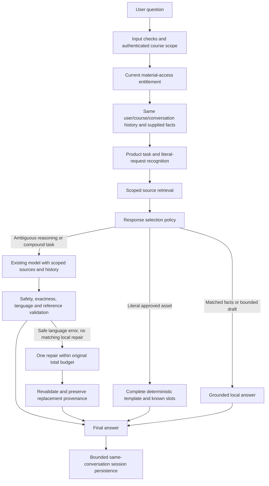

# Phase 9 root-cause architecture analysis

Course: AI Product Photoshoot & Ads. Evidence: the completed Phase 8 package, all 100 raw responses, frozen definitions, independent 35-body audit and seventeen-case independent failure review. No new provider evaluation was run in Phase 9.

## Finding

Poor unseen-question performance is primarily a control-flow problem, with correlated evaluator blind spots. The required course facts/assets exist. Before Phase 9, loosely matched keywords selected deterministic text before any provider call, and response validation could substitute a different topic after a correct model answer. The route saved message history but loaded only structured fields. Therefore a large local-answer share did not establish correct learner-task understanding.

Phase 8 measured 49/50 reused and 37/50 new questions, 32/35 complete templates, and 106 local / 11 model / 2 replacement turns. Passing 239 backend and 111 evaluator checks did not establish broad generalization. Phase 9 preserves those results.

## Actual pipeline and decision boundaries

1. **Question, authentication and course scope:** `routes/ai.js` performs input checks, compatible-auth middleware, rate limiting and course resolution. Plan/account answers retain their existing priority. No auth/entitlement bypass is added.
2. **Context/access:** `buildContext` in `services/aiTutorService.js` resolves published course and selected lesson, checks current access through existing subscription rules, and retrieves scoped references. Product history is restored only after active material access and actual product-course scope are verified. Client history takes priority when supplied. Server history requires the same authenticated user query, course and explicit conversation ID; it is sanitized to 12 turns, 2,000 characters each. It is untrusted conversation context, never verified product or course facts.
3. **Task recognition:** `productTutorKnowledge.js` extracts explicit user facts and task context. The new `productTutorIntent.js` describes compound, whole-journey, reasoning, location and colour-action signals. Descriptive colour alone no longer selects a recolouring lesson. Exact requests include original/complete/entire wording; a negated saved-prompt mention or prompt-location question is not a literal-body request.
4. **Retrieval:** `tutorKnowledge.js` retains course/access boundaries and six selected records. Exact assets get strong priority; whole-journey/compound questions receive their requested workflow and location sources rather than one narrow FAQ. All eight lessons and nineteen complete bodies remain intact in 53 unique records.
5. **Response selection:** exact assets are deterministic. Safety refusals, explicitly requested supplied facts, clearly matched course facts and bounded conservative drafts remain local. Open reasoning, unfamiliar ambiguity and compound/full-course-journey tasks go to the existing configured model. A local answer needs a matching task/source, rather than only an explicit lesson number or weak top chunk. Debug metadata records the policy reason.
6. **Model generation:** the existing provider adapter and approved endpoint configuration remain. The prompt includes current language, every requested part, retrieved course sources and bounded prior context. No new provider was added and none was contacted in this phase.
7. **Validation:** full literal assets can be repaired directly from authorized source. Matched course repairs can be localized without changing topic. A safe ambiguous answer in the wrong language gets one model-repair request sharing the original 25-second total budget, with maxAttempts=1 for repair. The initial adapter remains maxAttempts=2; total maximum is three transport attempts within the shared budget. Corrected output is revalidated. Failed repair explicitly reports incompletion and retains the safe original as reference; it cannot count as a completed v6 answer. A safety violation still gets immediate safe replacement, never translation of an unsafe endorsement.
8. **Final output/state:** local, model, validation replacement and fallback provenance remain distinct. A repaired model answer is not labeled unchanged live output. Optional product-context language and existing message storage preserve facts, lesson, intent and reasoning decisions. Legacy sessions without the new language field can restore history. No infrastructure/schema migration is run.

## Root causes, evidence and correction

| Root cause | Phase 8 evidence | Architectural correction | Deterministic or model? |
|---|---|---|---|
| Request preposition consumes the later product phrase | unseen_001 and unseen_006 leave supplied names unresolved; v5 repeats the parsing mistake | Overlapping bounded candidate extraction, rejection of request prose, complete-body rendering and independent predeclared-slot audit | Deterministic literal renderer; independent audit |
| Literal request missed despite retrieved asset | unseen_005 returns model-shot summary instead of Character Sheet | Recognize complete original requests and prioritize the entire authorized asset; no unrelated workflow substitute | Deterministic |
| Generic keyword overwhelms requested task | Hindi descriptive colour selects variants in unseen_023 | Require colour-changing intent; route unfamiliar reasoning to the model with source context | Task cues plus model reasoning |
| Recall shortcut misreads informational question | unseen_020 echoes name instead of facts needed for ads | Recall requires actual past-facts language; generic-ad question retrieves ad-plan guidance | Deterministic known facts; model when ambiguous |
| Exact flag chooses any FAQ | unseen_048 ignores L06 configuration for morphing repair | Exactness binds to requested task; FAQ preference requires a matched troubleshooting topic | Deterministic settings/source matching |
| Narrow FAQ drops another requested part | unseen_038 and unseen_050 omit full journey/workflow | Compound/full-journey selection and retrieval coverage; model receives both parts | Model synthesis from sources |
| Omitted client history loses a selected choice | unseen_049 asks clarification after a correct first answer | Restore bounded messages after current scope/access checks; selected choice is conversation, not a newly invented product fact | Deterministic state, model explanation |
| Language replacement discards correct repair | unseen_018 upstream gives L04 repair; replacement becomes L02 | Fix task recognition; preserve relevant repair locally or use one bounded contextual language repair | Local for known literal repair; model for prose |
| Overbroad negation detection discards safe comparison | unseen_024 is replaced with generic refusal; unseen_040 falsely unsafe | Clause-scoped Hindi/Roman prohibitions, with affirmative-claim negative controls | Deterministic safety checks, model comparison |
| Finite scorer misses genuine content | regenerate false failures; known-slot false passes; incomplete comparison passes | Separate v6, negative controls and independent full-source auditor | Offline deterministic checks plus review |

## Why this is not a model-only router

Literal fidelity, access control, product-slot substitution, recorded settings, source identity, provenance, scope and retry budgets are software invariants. A model should not rewrite approved template bodies or decide entitlement. Short unambiguous recorded workflows can be returned locally. A supplied name also suffices for conservative original hooks/captions without invented claims.

The existing model is better suited to explaining trade-offs, interpreting unfamiliar prose, comparing ideas, answering multiple grounded requests, and restating a prior reasoning decision. The policy delegates these tasks without adding examples from the evaluation corpus to runtime knowledge. Handlers and graders never branch on evaluation IDs or read reports. The boundary is still finite and requires future live evidence; it does not prove every unfamiliar intent is understood.

## Independent evaluator review

V5 stays byte-for-byte unchanged. V6 changes implementation of the existing requirements, not the targets or historical acceptance thresholds. Three false failures are corrected (two regenerate equivalents and a Hindi prohibition). Three false passes are exposed (two unresolved known-product templates and a missing requested distinction). The mixed not-claim wording improves, but its missing lesson reference still fails. Both old and corrected historical totals happen to be 86/100; different case outcomes and dimensions are retained in the new output. This is not new chatbot performance.

The independent auditor imports neither runtime nor grader entity parsing. It validates frozen reviewer-declared slots against the original source, then checks the whole executable body. It rejects altered expected source, wrong/unresolved known slots, truncation, appended instructions and extra executable blocks. On old answers it reproduces 32/35; on new local literal handlers it gets 35/35. Unknown actor/clothing fields legitimately remain unknown.

## Constraints and practical limits

No provider call, deployment, commit, push or production-resource change occurred. Model-selected requests were not generated live. Route tests use synthetic auth/session/provider dependencies. No new live accuracy is claimed. More model-eligible work and occasional repair may increase latency/cost; generation and repair share one bounded budget. Safety and intent checks remain finite; see remaining issues before deployment decisions.
